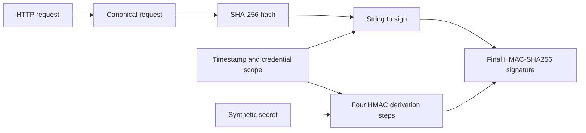

# AWS SigV4 Canonical Request

An offline, educational implementation of AWS Signature Version 4 for S3 GET requests, built with .NET 10. It exposes canonicalization and cryptographic stages using fixed timestamps and AWS's published synthetic credentials. It never sends requests to AWS or discovers local credentials.



## Build and verify

Install a stable .NET 10 SDK, then run:

```sh
dotnet restore
dotnet build -c Release --no-restore
dotnet test -c Release --no-build
```

The tests compare exact canonical-request bytes, hashes, scopes, strings to sign, and signatures against three [published AWS S3 GET examples](https://docs.aws.amazon.com/AmazonS3/latest/developerguide/sig-v4-header-based-auth.html#examples-signature-calculations). Additional tests specify encoding, duplicate query pairs, header normalization, and invalid-input behavior locally. Passing these offline tests does not establish live AWS interoperability.

## Try it

Run these from the repository root after building:

```sh
dotnet run --project src/SigV4.Cli -c Release --no-build -- list
dotnet run --project src/SigV4.Cli -c Release --no-build -- verify-examples
dotnet run --project src/SigV4.Cli -c Release --no-build -- verify-experiments
dotnet run --project src/SigV4.Cli -c Release --no-build -- explain --example aws-get-object --html artifacts/request.html --json artifacts/request.json
dotnet run --project src/SigV4.Cli -c Release --no-build -- compare --experiment space-as-plus --html artifacts/comparison.html
dotnet run --project src/SigV4.Cli -c Release --no-build -- explain --input examples/custom-request.json --html artifacts/custom.html
```

Open a generated HTML file directly in a browser. It contains its own CSS, uses native anchors and expandable byte views, and needs no server, scripts, fonts, or network access. The pipeline shows all public intermediate values, raw input pairs, exact canonical text, UTF-8 lengths/hexadecimal bytes, visible whitespace, and redacted key derivation. Experiment reports show baseline and variant values side by side and identify the first divergent stage. JSON exports contain the same nonsecret trace data.

`explain` accepts exactly one of `--example` or `--input`; `compare` requires `--experiment`. HTML and JSON export flags are optional. Existing files require `--force`; input and output paths must be distinct and cannot contain one another. Each output file is replaced atomically, but multiple exports are not one filesystem transaction. Generated artifacts are ignored by Git.

Exit codes are `0` for success (including an expected experiment mismatch), `1` for a verification mismatch, and `2` for input, usage, or file errors. An input scenario with incorrect expected values still exports the computed trace for diagnosis before returning `1`.

For a portable application directory:

```sh
dotnet publish src/SigV4.Cli -c Release -o artifacts/publish
dotnet artifacts/publish/sigv4.dll verify-examples
```

This framework-dependent output requires the .NET 10 runtime. Restore, SDK installation, and CI can access package feeds; the running signer and reports are offline.

## Supported signing contract

- Header-based SigV4 for S3 `GET`, with an empty body hashed using SHA-256.
- Explicit whole-second UTC timestamps, Region, and the `aws-documentation` synthetic credential preset.
- Unescaped logical paths and query names/values; percent signs are literal input and are encoded once. Repeated slashes and dot segments in S3 paths are preserved.
- Query pairs retain duplicates and empty values, and sort by encoded name then encoded value using ordinal comparison.
- Exactly one `Host` header containing an ASCII DNS hostname and optional numeric port is required; IPv6 authorities are outside scope. Every supplied header is signed. The signer adds `x-amz-date` and `x-amz-content-sha256` when missing, and checks consistency when supplied.
- Header names are lowercase and sorted; spaces/tabs in values are trimmed and collapsed; repeated values join with commas in input order.
- Canonical text uses UTF-8 and LF newlines. The HTTP display uses CRLF and preserves caller-supplied header presentation.
- Secret and derived-key bytes are excluded from traces; derivation outputs display `[redacted]`.

Presigned URLs, request bodies, temporary credentials, volatile transport headers, arbitrary secret keys, and SigV4a are outside scope. This project is an educational signer, not a replacement for the AWS SDK.

## Structure

- `src/SigV4.Core`: validated request model, S3 encoding, canonicalization, signing, and nonsecret trace.
- `src/SigV4.Experiments`: controlled comparisons and deliberately faulty rules, isolated from the correct public signer.
- `src/SigV4.Reporting`: self-contained, HTML-escaped reports and byte inspection.
- `src/SigV4.Cli`: scenario loading, command handling, verification, and file exports.
- `examples/aws-*.json`: frozen published vectors with expected intermediate values and provenance.
- `examples/custom-request.json`: editable local scenario without published expectations.
- `tests/SigV4.Tests`: protocol, experiment, rendering, and CLI regression tests.
- `.github/workflows/ci.yml`: Release build, tests, formatting, and CLI verification on Linux and Windows; GitHub Actions are pinned to immutable commits.

## Controlled experiments

`ExperimentCatalog.Run(id)` returns baseline and variant traces, the predicted result, and the first divergent signing stage. A successful experiment can intentionally produce different signatures: `Passed` means the observed outcome agrees with the prediction.

| ID | Lesson | Expected signatures |
| --- | --- | --- |
| `query-order` | Sorting removes query input-order differences | Same |
| `header-normalization` | Header-name casing and permitted whitespace normalize | Same |
| `skip-query-sort` | A faulty signer preserves unsorted query input | Different |
| `space-as-plus` | A faulty signer uses `+` instead of `%20` | Different |
| `skip-header-normalization` | A faulty signer retains header whitespace | Different |
| `request-tampering` | The actual signed object key changes | Different |

Faulty rules only change the canonical representation through an internal entry point available to the experiment assembly. `S3RequestSigner.Sign` always uses the correct rules. The HTTP display represents the supplied request and generated Authorization header; faulty canonical fields deliberately disagree with that request.

## Scenario files and reproducibility

Use the wrapper format in `examples/custom-request.json`: `id`, `title`, optional `sourceUrl`, required `request`, and optional `expected`. Request fields are `method`, `path`, `query` (name/value pairs), `headers` (name/value pairs), `timestamp`, `region`, `service`, and `credentialPreset`. Defaults are `GET`, `/`, empty query/headers, `us-east-1`, `s3`, and `aws-documentation`; timestamp has no clock-based default and Host is always required. Unknown fields, malformed/incomplete pairs, null required values, unsupported credentials, and inconsistent signing headers are rejected. Scenario files never accept a secret key.

If supplied, `expected` must contain `canonicalRequest`, `canonicalRequestHash`, `credentialScope`, `stringToSign`, and `signature`. The example files preserve published expectations rather than deriving them from this implementation. Source notes are metadata only and are never fetched.

Signing values are deterministic for fixed inputs. Diagnostic elapsed times vary between runs and include runtime initialization costs on the first call. Each uncached run performs two high-level SHA-256 operations and five HMAC-SHA256 operations, including four for key derivation. Report generation and file I/O are excluded from the signing timer; no performance threshold is asserted.

See [CONTRIBUTING.md](CONTRIBUTING.md) for coding and verification conventions.
